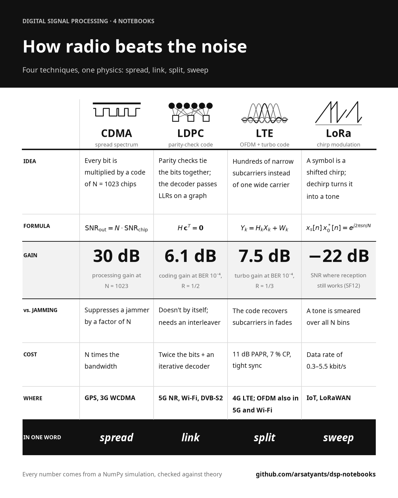
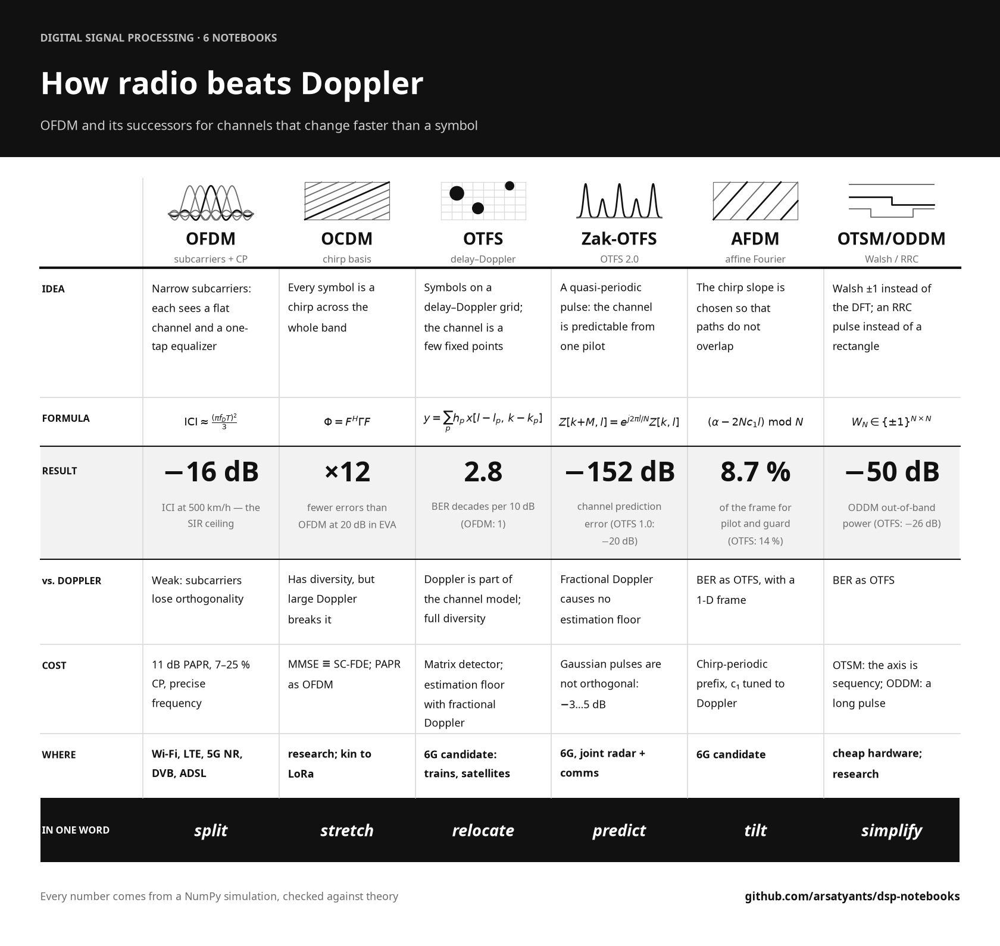

# DSP Notebooks

Physics-first explainers of wireless signal processing, written as Jupyter notebooks. Each notebook takes one technique, works through the math behind it, and checks that math with a compact NumPy simulation. Every section prints the theoretical prediction next to the measured value.

Every notebook comes in two versions with identical code: English (`*_en.ipynb`) and Russian (`*_sim.ipynb`).

## At a glance





Russian versions: [comparison_ru.png](assets/comparison_ru.png) · [doppler_ru.png](assets/doppler_ru.png). Regenerate with `python tools/infographic.py <ru|en> [classic|doppler]`.

## Notebooks

| Notebook | Topic | What you'll see |
|---|---|---|
| [English](notebooks/basics_sim_en.ipynb) · [Русский](notebooks/basics_sim.ipynb) | **Basic concepts (start here)** | The vocabulary of the series in 12 levels from simple to complex, each checked numerically: sampling and aliasing, I/Q, dB; spectrum and bandwidth; AWGN, SNR, Eb/N0, BER, EVM, Shannon; constellations, Gray code, LLR; ISI, RRC, eye diagram, matched filter; correlation, orthogonality, m-sequences, Gold, Zadoff–Chu, processing gain; chirps and pulse compression; multipath, coherence bandwidth, Doppler, Rayleigh/Rice; equalizers and diversity; OFDM, CP, PAPR; Hamming code and coding gain; the delay–Doppler domain; an index of terms and a reading order |
| [English](notebooks/cdma_sim_en.ipynb) · [Русский](notebooks/cdma_sim.ipynb) | **CDMA / DSSS** | Spreading with m-sequences and Gold codes, processing gain, code acquisition via FFT, narrowband jammer suppression, two users sharing one band, BER vs. BPSK |
| [English](notebooks/ldpc_sim_en.ipynb) · [Русский](notebooks/ldpc_sim.ipynb) | **LDPC codes** | Parity checks and syndromes (Hamming 7,4), step-by-step Gallager (3,6) construction, cycles and girth, GF(2) encoding, channel LLRs, the ⊞/tanh check rule and min-sum, extrinsic vs. echo, BP traced by hand on a 12-bit code, EXIT and Monte Carlo density-evolution thresholds, flooding vs. layered schedules, bit-flipping vs. BP, BER/FER waterfall vs. the Shannon limit, code length and min-sum α |
| [English](notebooks/turbo_sim_en.ipynb) · [Русский](notebooks/turbo_sim.ipynb) | **Turbo codes** | Recursive vs. non-recursive convolutional codes, the RSC trellis and termination, QPP interleaver and low-weight codewords, BCJR derived and checked against brute force, max* vs. max-log, extrinsic vs. echo, turbo iterations traced by hand (K=40), EXIT chart and threshold, BER/FER waterfall vs. a single RSC, interleaver and block-length effects, turbo vs. LDPC at R≈1/2 |
| [English](notebooks/transforms_sim_en.ipynb) · [Русский](notebooks/transforms_sim.ipynb) | **Fourier, wavelets, Fresnel** | Windows and leakage, the convolution theorem, the uncertainty relation and the STFT, the Morlet CWT (constant Q), the DWT as a Mallat filter bank and vanishing moments, Fresnel diffraction by a slit and the Fraunhofer limit, the Talbot effect, the discrete Fresnel transform (chirp → delta), sparsity and threshold denoising in each basis |
| [English](notebooks/ofdm_sim_en.ipynb) · [Русский](notebooks/ofdm_sim.ipynb) | **OFDM** | Subcarrier orthogonality and the FFT as a filter bank, the CP plateau for the FFT window, spectrum and ACLR (guard bands, WOLA, f-OFDM), Schmidl–Cox synchronization and CFO-induced ICI, phase noise (CPE vs ICI) and IQ imbalance, PAPR reduction (SLM, clipping) vs a Rapp amplifier, DMT bit loading and water-filling, 5G NR numerology vs delay spread and Doppler |
| [English](notebooks/lte_sim_en.ipynb) · [Русский](notebooks/lte_sim.ipynb) | **LTE downlink PHY** | OFDM and the cyclic prefix, 3GPP EPA/EVA/ETU channels, ISI/ICI vs. CP length, CRS pilots and channel estimation, Doppler ICI, QAM BER in AWGN and fading, the LTE turbo code (QPP interleaver, log-MAP / max-log-MAP), turbo vs. LDPC, frequency diversity, OFDM vs. SC-FDMA PAPR |
| [English](notebooks/lora_sim_en.ipynb) · [Русский](notebooks/lora_sim.ipynb) | **LoRa / CSS** | Chirp modulation, dechirp + FFT demodulation, SER for SF7–SF12 against non-coherent M-ary orthogonal theory, link budget and time-on-air, CFO/timing recovery from up- and down-chirps, tone jamming, cross-SF quasi-orthogonality |
| [English](notebooks/ocusync_sim_en.ipynb) · [Русский](notebooks/ocusync_sim.ipynb) | **DJI OcuSync / DroneID vs. LTE** | The reverse-engineered DroneID burst (LTE 10 MHz numerology, 9 symbols), Zadoff–Chu roots 600/147 and their time–frequency ambiguity, ZC detection vs. the LTE PSS, CP + ZC synchronization from scratch (fractional and integer CFO), Rician air-to-ground channel and MRC, ZC channel estimation with DFT denoising, the LTE turbo code with rate matching to 7200 bits (end-to-end BLER), two-ray link budget and bandwidth adaptation, Wi-Fi interference and frequency hopping (MIESM) |
| [English](notebooks/otfs_sim_en.ipynb) · [Русский](notebooks/otfs_sim.ipynb) | **OTFS** | The doubly dispersive channel in time–frequency vs. delay–Doppler, one DD symbol as a pulse train, ISFFT ≡ IDFT over Doppler, DD input–output and fractional Doppler (Dirichlet kernel), OFDM ICI vs. speed, uncoded BER OFDM vs. OTFS at 500 km/h (diversity), embedded-pilot channel estimation, message-passing detector vs. LMMSE, PAPR ≤ N |
| [English](notebooks/zak_sim_en.ipynb) · [Русский](notebooks/zak_sim.ipynb) | **Zak-OTFS (OTFS 2.0)** | The discrete Zak transform and quasi-periodicity, the pulsone, non-commuting delay/Doppler and the twisted convolution (checked against time-domain simulation), rectangular vs. Gaussian DD filters (Dirichlet vs. Gaussian tails), predictability of the whole channel from one pilot and the crystallization condition, model-free estimation BER vs. classic OTFS, sub-bin Doppler sensing, radar view: the pulsone as a pulse-Doppler train, the DZT as a slow-time FFT, the bed-of-nails ambiguity function, a monostatic range–Doppler map from the pilot vs. the whole frame |
| [English](notebooks/afdm_sim_en.ipynb) · [Русский](notebooks/afdm_sim.ipynb) | **AFDM** | The DAFT chirp family (OFDM, OCDM and AFDM as special cases), the chirp-periodic prefix, how paths map to α − 2Nc₁l in the DAFT domain, BER of OFDM / OCDM / AFDM / OTFS on one doubly dispersive channel, a 1-D embedded pilot with half the OTFS guard overhead |
| [English](notebooks/ocdm_sim_en.ipynb) · [Русский](notebooks/ocdm_sim.ipynb) | **OCDM** | Chirp basis and the discrete Fresnel transform (Φ = FᴴΓF), why OCDM with MMSE equals SC-FDE exactly, uncoded BER vs. OFDM in EVA, partial-band interference, delay–Doppler coupling under high Doppler, PAPR |
| [English](notebooks/otsm_sim_en.ipynb) · [Русский](notebooks/otsm_sim.ipynb) | **OTSM / ODDM** | Walsh functions and a multiplier-free modulator, the delay–sequency channel (same singular values as OTFS), OTSM vs. OTFS BER, ODDM's RRC pulse: out-of-band emission and DD-plane orthogonality; series wrap-up table |

The notebooks refer to each other. For example, LoRa's processing gain is compared with DSSS, and the turbo code (in the LTE and turbo notebooks) is benchmarked against the LDPC code at the same rate and block length.

## Structure of each notebook

1. Intro: the physical problem and the key equations.
2. A single **parameters cell** (SNR, spreading factor, bandwidth, channel profile, …).
3. A self-contained **primitives cell** (modulators, channels, decoders), with no dependencies beyond NumPy/SciPy.
4. Numbered simulation sections. Each has plots and printed theory-vs-simulation checks.
5. A comparison with the other notebooks.
6. **Things to try** ("Что покрутить" in the Russian version): parameter changes that show where things break.

## Running

```bash
python -m venv .venv
source .venv/bin/activate
pip install -r requirements.txt
jupyter notebook notebooks/        # or open in VS Code
```

The notebooks are committed with their outputs, so you can read them on GitHub without running anything. To re-execute one from the command line:

```bash
jupyter nbconvert --to notebook --execute --inplace notebooks/lora_sim_en.ipynb
```

Approximate run times on a laptop CPU: CDMA and LoRa take under a minute. LDPC, turbo, OFDM, LTE, OcuSync and the delay–Doppler notebooks (OTFS, Zak-OTFS, AFDM, OCDM, OTSM/ODDM) take a few minutes each, mostly in the BER sweeps. Run them one at a time: two kernels doing large matrix inversions in parallel slow each other down many times over.

## Requirements

Python 3.10+, `numpy`, `scipy`, `matplotlib`, plus `ipykernel` / `nbconvert` / `nbformat` for running them (see [`requirements.txt`](requirements.txt)).
